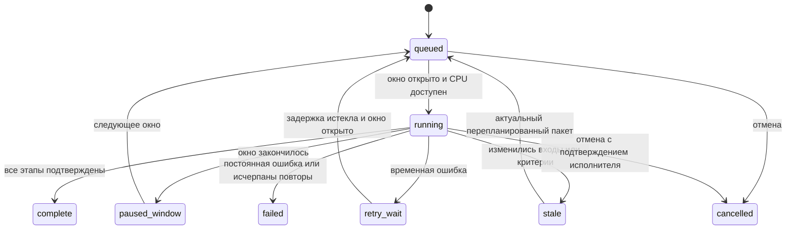

# Ночная сверка: проект реализации

Статус: реализованы расписание администратора, долговечная очередь, контрольные
точки, восстановление и приоритет ручного поиска. Инструкция текущей версии:
[NIGHT_SEARCH.md](NIGHT_SEARCH.md). Расписание по умолчанию выключено.
Ниже сохранён проект развития: инкрементальный кэш отдельных пар, адаптивные пакеты
и дополнительные уведомления относятся к следующим этапам. Автопубликации нет.

## 1. Назначение и область проверки

Ночью проверяются активные личные профили сотрудников-пользователей, которым
разрешена работа с личным массивом. Для каждого владельца выполняются те же этапы:

1. Его личный массив: дубликаты между его объектами.
2. Опубликованный мастер-массив его организации.
3. Активные эталоны сотрудников его организации, с прежним исключением собственного
   опубликованного эталона только при совпадении актуальной опубликованной ревизии.

«Все сотрудники» не означает доступ каждого пользователя к чужим личным массивам.
Сверка между неопубликованными личными массивами разных владельцев не включается
в этот механизм. Изменить это правило можно только отдельным требованием о правах.
ФИО и регистрационный номер сотрудника не используются для объединения профилей.

Исключаются удалённые/неактивные профили, отключённые пользователи и организации.
Пустой генотип и недостаточное число локусов дают прежние состояния NO_GENOTYPE и
INSUFFICIENT_DATA, а не успех. Профили, меняющиеся во время работы, не получают
ложную отметку актуальности. Эталоны сотрудников и объекты экспертиз не смешиваются.

## 2. Настройки администратора

Предлагается раздел «Настройки → Ночная сверка» в пределах своей организации.
Управление расписанием не даёт права подтверждения мастер-массива
`can_approve_master` и не расширяет доступ к генотипам.

| Настройка | Поведение |
|---|---|
| Включено | По умолчанию выключено; включается после настройки и пробного запуска |
| Часовой пояс | IANA timezone, исходное предложение Europe/Moscow; сохраняется явно |
| Дни недели | Дни **начала** окна в выбранном часовом поясе |
| Время начала / окончания | Задаёт администратор; никакого обязательного окна 22:00–07:00 |
| Окончание окна | Предлагаемый безопасный вариант: закончить текущий небольшой пакет и приостановить; альтернатива — продолжить с пониженным лимитом |
| Максимум потоков | Не больше общего бюджета CPU/cgroup; не отдельный лимит на каждого сотрудника |
| Доля ресурсов ночью / днём | Ограничение фонового исполнителя; днём по умолчанию пауза |
| Размер пакета | Автоподбор по времени/памяти с ограничениями, без необходимости подбирать его вручную |
| Получатели уведомлений | Владелец — о своих совпадениях; администратор — о состоянии очереди и ошибках |
| Хранение истории | Настраиваемое; отдельные сроки для полных результатов, коротких итогов и аудита |

Начало и конец не могут совпадать: это ошибка настройки, а не скрытые 24 часа работы.
Окно через полночь относится к дню его начала: понедельник 23:00–вторник 06:00 —
понедельничное окно. Интерфейс показывает следующие несколько запусков с датой,
часовым поясом и UTC-смещением. Сервер вычисляет расписание, браузер только отображает.
Для timezone с переводом часов пропущенное/повторное локальное время обрабатывается
один раз по задокументированному правилу; ключ окна использует локальную дату начала,
версию расписания и организацию. Нельзя запускать повторную ночь из-за перевода часов.

Редактирование расписания сохраняет новую версию. Отключение отменяет постановку
новых пакетов и запрашивает паузу выполняющихся. Включение не запускает расчёт
немедленно вне окна. «Пробный запуск сейчас» — отдельная явная команда с оценкой
объёма и нагрузки. Пропущенные ночи не воспроизводятся по одной: в ближайшем окне
проверяется актуальное состояние, без лавины исторических заданий.

## 3. Архитектура и долговечная очередь

Планировщик только создаёт/возобновляет задания. Он не делает массовый POST к HTTP
API от имени всех пользователей, не хранит их пароли/JWT и не зависит от открытого
браузера. Отдельный фоновый процесс исполняет расчётные пакеты существующим кодом.
Redis может ускорять уведомления, но не является единственным хранилищем очереди:
потеря Redis не должна терять задание, результат или контрольную точку.

Существующий `scheduledJobService` уже запускает очистку данных, сессий и аудита.
Он не является долговечной очередью расчётов. Новое расписание нужно согласовать
с очисткой, резервным копированием и обновлениями: очистка не удаляет активные снимки,
а массовые задания не конкурируют за весь I/O с резервной копией. Время таких работ
учитывается в мониторе нагрузки, а не предполагается, что ночью сервер всегда свободен.

Предлагаемые сущности (новая самостоятельная миграция, не правка 037–039):

| Сущность | Ключевые поля и ограничения |
|---|---|
| `workspace_night_policies` | organization_id, enabled, timezone, days, start/end, finish_policy, resource_limits, revision, updated_by |
| `workspace_search_jobs` | organization_id, owner_id, workspace_id, window_key, origin, priority, parameters_hash, algorithm_version, snapshot_manifest, state, attempt, lease_token, lease_until, heartbeat_at |
| `workspace_search_job_chunks` | job_id, stage, deterministic range, input revisions, state, attempt, checkpoint, encrypted result reference; уникальный ключ пакета |
| `workspace_search_stage_coverage` | версия источника/набора/настроек, завершённые диапазоны, ссылка на проверенные результаты; отдельный учёт отрицательных результатов |
| `workspace_search_job_events` | состояние, время, код причины, счётчики; без аллелей, ФИО и токенов |

Идентификатор окна предотвращает двойное планирование. Одновременно допускается
не более одного актуального фонового задания на workspace и набор параметров.
Повторная постановка объединяет изменения или заменяет устаревший план, не размножает
задания. Организация, владелец и workspace обязательны во всех запросах и индексах.

Захват пакета — короткая транзакция с `FOR UPDATE SKIP LOCKED`, арендой и уникальным
токеном исполнения. Аренда продлевается heartbeat. Истекшая аренда позволяет повтор,
но результат старого исполнителя отклоняется по токену: одного heartbeat недостаточно.
Расчёт и ожидание CPU происходят **вне** транзакции и без удержания соединения БД.
Запись результата и контрольной точки пакета атомарна. Повтор после сбоя идемпотентен.

## 4. Состояния и действия

Дополнительные причины ожидания хранятся отдельно: CPU, ручной поиск, БД, память,
выход из окна, временная недоступность исполнителя. «Идёт поиск» без heartbeat не
показывается бесконечно: UI сообщает о потере связи и последнем подтверждённом шаге.
Статус `complete` не означает «совпадений нет»: результат может содержать дубликаты
и контаминации. Ошибка одного владельца не отменяет обработку остальных.

Действия администратора: включить/отключить расписание, пауза/возобновление, повторить
сбойные, отменить запуск, посмотреть причины ожидания. «Пауза» сохраняет завершённые
пакеты; «отмена» не делает незавершённые проверки пригодными для публикации.
Нельзя редактировать аллели или принудительно выставлять CHECKED из монитора очереди.

## 5. Что считать изменением

Используются реальные зависимости, а не только `updated_at`:

- `dna_profiles.analysis_revision` и существующий `analysisHash`: генотип, номер,
  год и тип. Один и тот же номер в разные годы остаётся разными объектами.
- `personal_workspaces.analysis_revision`: состав массива и параметры поиска.
- `workspace_reference_versions.master_revision` и `staff_revision`.
- Версия кода алгоритма и полный нормализованный набор параметров, включая
  ignoredLoci, веса, коэффициенты, все пороги и выбор версии v4/v5.
- Актуальность ссылок публикации и исключений собственного эталона сотрудника.
- Активность пользователя/организации и действующие права на источники.

Ночные настройки расчёта берутся из **сохранённых сервером настроек владельца**.
Значения только из localStorage браузера недоступны исполнителю. Перед первым
ночным запуском такие параметры нужно явно сохранить на сервере и показать пользователю;
нельзя молча заменить его v4/веса/пороги новыми дефолтами. Администратор управляет
расписанием и ресурсами, но не переписывает научные настройки всех пользователей.

## 6. Безопасная инкрементальная сверка

Первый этап реализации — пропуск полностью актуальных workspace. Если зависимости
изменились, выполняется обычный полный поиск актуального workspace. Это проще
проверить и безопаснее, чем сразу внедрять частичный пересчёт каждого результата.

Следующий этап — кэш **направленных** пар/диапазонов и подтверждённого покрытия:

| Изменение | Необходимая работа |
|---|---|
| Новый/изменённый личный профиль A | A против всего своего массива, мастера и сотрудников; также остальные личные объекты против A |
| Удалённый/деактивированный A | Убрать относящиеся к нему результаты и обновить состав/покрытие |
| Новый/изменённый мастер-эталон M | Актуальные личные профили против M; заменить старые пары, не дописать вторую копию |
| Удалённый мастер-эталон | Исключить связанные совпадения и подтвердить новую версию набора |
| Изменённый сотрудник S | Соответствующий staff-этап всех затронутых workspace, включая самоисключения и половые критерии |
| Изменились параметры | Пересчитать зависимый этап; на первом этапе внедрения — весь workspace |
| Новая версия алгоритма | Пересчитать все результаты соответствующего алгоритма |
| Изменены только ФИО/комментарий | При допустимости по текущим правилам обновить отображение/снимок, не переписывая генотип |

Нельзя считать A→B эквивалентным B→A: в действующих алгоритмах есть направленные
ветви. Даже если стандартный поиск симметричен, отображение эталонов, исключения
и экспорт требуют стабильного порядка. Удаление или изменение одной записи требует
убрать её прежние совпадения и отрицательные результаты, а не только добавить новые.

Ключ повторного использования включает организацию, владельца/область доступа,
этап, направление, версии обоих входов, параметры, алгоритм и версию эталонного набора.
Кэш не делается глобальным по одному номеру, ФИО или одному хешу генотипа.
Отсутствие строки совпадения не доказывает отрицательный результат: требуется
сохранённое покрытие проверенного диапазона. Top-100 в интерфейсе не ограничивает
проверку, хранение полного результата или XLSX-экспорт.

Нужен журнал изменений эталонов или эквивалентный versioned manifest: нынешний
счётчик ревизии сообщает, что набор изменился, но сам по себе не сообщает **что именно**.
Пока такого журнала нет, изменение эталонной ревизии требует полного пересчёта
зависимого этапа. «Проверять только новые» без учёта правок/удалений недопустимо.

## 7. Снимки и публикация

Задание получает согласованный снимок: исходные ревизии, наборы эталонов, параметры,
порядок локусов, права и версию алгоритма. Снимок создаётся в короткой транзакции;
ночная read-only транзакция на несколько часов не удерживается, чтобы не мешать VACUUM.
Повторно использовать один снимок эталонов внутри организации можно только с явной
версией, сроком жизни, шифрованием и проверками доступа; личные массивы не объединяются.

Перед финализацией повторно проверяются ревизии, активность, права и lease/fencing
token. Если входы изменились, результат становится stale и перепланируется; он не
получает фиктивную актуальность. Число повторов ограничено, с задержкой: активно
редактируемый массив не должен бесконечно занимать всю ночь.

Нынешние `workspace_search_profiles` и gate миграций 037–039 требуют актуальную
полную проверку всех трёх этапов. Эти ограничения сохраняются. На первом этапе
исполнитель вызывает полный поиск и не подставляет старые proof-записи. На этапе
инкрементального кэша нужна отдельно проверенная сборка **нового** доказательства
полного покрытия актуального снимка, согласованная с gate и транзакциями. Копирование
старого CHECKED в новую ревизию не является допустимой оптимизацией.

Ночное задание ничего не публикует и не подтверждает за человека. Найденные совпадения
не ведут к автоматическому слиянию, деактивации, замене генотипов или комментариев.
Подтверждение мастер-массива остаётся отдельным действием уполномоченного пользователя.

## 8. Ресурсы и приоритет ручной работы

Сейчас очередь и бюджет workers ограничены одним процессом Node.js. Для нескольких
web-реплик и фонового исполнителя этого недостаточно: каждой реплике нельзя дать
независимые «ещё 4 потока». Нужен общий лимит/аренда CPU-слотов между процессами и
ограничение CPU/памяти контейнера исполнителя с учётом cgroup.

Ручной поиск имеет приоритет. Фоновая работа уступает на границе короткого пакета;
нельзя держать общий слот на весь многочасовой запуск. Пакет подбирается по замерам,
например с целевым временем нескольких секунд и жёстким ограничением входа/выхода.
Один «тяжёлый» объект против большого мастера делится по кандидатам. Все части
сохраняют глобальный порядок локусов, порядок равных баллов и полный экспорт.

Дополнительно ограничиваются: чтение БД, число загруженных снимков, размер результата,
объём шифрования и дисковые операции. Снимки не загружаются заранее для всей очереди.
При нехватке памяти задание остаётся в очереди или уменьшается пакет, а не запускается
ещё больше потоков. Соединения БД не удерживаются во время ожидания и расчёта.

Постоянный пул workers и переиспользование подготовленных индексов можно добавить
после профилирования. Они не должны сохранять генотипы чужого владельца/организации
при переключении контекста. Измеряется пиковая память **всего** процесса, включая
structured clone, временные объекты, сериализацию и полный результат, а не только heap
одного worker. Число потоков само по себе не является показателем ускорения.

## 9. Восстановление и ошибки

- Перезапуск web не теряет ночной job; закрытие браузера не отменяет его.
- Перезапуск исполнителя возвращает пакеты с истёкшей арендой в очередь.
- Ошибка PostgreSQL/временный сетевой сбой: ограниченные повторы с backoff и jitter.
- Недопустимые данные/права/неизвестная версия: постоянная причина, без бесконечных повторов.
- Сбой одного worker отменяет пакет; частичный результат не объявляется полным.
- Смена параметров или эталонов: stale; новый план не смешивает старую и новую версии.
- Окончание окна: завершить текущий малый пакет, затем paused_window. Жёсткая остановка
  по таймауту допускается, но незавершённый пакет выполняется повторно целиком.
- Заблокированное соединение БД имеет отдельный query timeout; отмена CPU не должна
  оставлять неограниченно зависший SQL-запрос.
- Ошибка ключа шифрования останавливает запись/чтение результата, без сохранения открытых
  генотипов «временно» в логи или незащищённые файлы.

Уже существующий ручной `/full-search/stream` имеет другой жизненный цикл: закрытие
соединения отменяет ручной расчёт, лимит — 10 минут. Он не заменяет долговечную очередь.

## 10. Интерфейс и отчёты

Владелец утром видит время последней **успешной** сверки, использованные параметры,
версии массивов, актуальность результата и новые/сохранившиеся/исчезнувшие совпадения.
Показываются только дубликаты и контаминации, а не список всех проверенных объектов.
Аллели, подсветка и Excel используют сохранённый снимок того же результата.
Ошибка или пауза не затирает предыдущий успешный результат, но его устаревание видно.

Администратор видит расписание, следующее окно, очередь, обработано/осталось,
ошибки, причины пауз, длительность, CPU/память и доступность исполнителя. Мониторинг
не открывает генотипы/ФИО чужих личных объектов без соответствующего права.
Счётчики различают логические пары, кандидатов после индекса, реально рассчитанные
пары и использованные результаты кэша. Процент — от зафиксированного плана текущей
попытки; новый план явно обозначается. Ожидание очереди не имитирует растущий прогресс.

Уведомления сначала внутри приложения. Email/Sentry/внешние каналы подключаются
отдельно; в них не отправляются генотипы, токены, ФИО или персональные идентификаторы.
Одинаковое совпадение не порождает уведомление каждую ночь: учитываются направление,
пара объектов, версии и изменение статуса. Автоматическое исчезновение совпадения
после удаления/изменения эталона отличается от результата повторного расчёта «не найдено».

## 11. Хранение, обновление, откат

Очередь, контрольные точки и права хранятся в PostgreSQL; чувствительные снимки и
результаты шифруются существующим механизмом. Новые постоянные файлы, если понадобятся,
располагаются только в локальных bind mount проекта `runtime/`, с ограниченными правами.
Сохраняются `.env`, `config/encryption.key`, БД и действующие локальные тома.

Очистка не удаляет доказательства и результаты, на которые ссылается публикация,
заявка или ещё работающий job. Нужна управляемая политика хранения и оценка роста,
особенно для плотных массивов с большим числом совпадений; основной фактор хранения —
выдача, а не только количество исходных объектов. Экспорт больших результатов
постраничный/потоковый по сохранённым парам, без повторного поиска текущих генотипов.

Перед выпуском: резервная копия, миграция с отключённым расписанием, проверка одной
тестовой организации, пробный реальный запуск под контролем администратора.
При обновлении активные пакеты завершаются или приостанавливаются. Старая версия
исполнителя не забирает job новой версии алгоритма. Откат приложения не включает
планировщик самопроизвольно и не требует удаления рабочих данных/томов.

## 12. Этапы внедрения и критерии готовности

1. **Наблюдаемость ручного поиска — текущая поставка:** серверные этапы/счётчики,
   окно прогресса, очередь, отмена, ошибки, отсутствие частичного результата.
2. **Долговечные задания:** таблицы jobs/chunks, аренды, fencing, общий бюджет,
   прогресс без браузера, рестарт и отмена. Алгоритмы и publication gate прежние.
3. **Расписание администратора:** окно/дни/timezone, пауза утром, dry run, монитор.
   Сначала обычный полный пересчёт только устаревших workspace.
4. **Инкрементальные этапы:** журнал изменений эталонов, кэш направленных результатов,
   покрытие отрицательных проверок, атомарная сборка актуального полного proof.
5. **Масштабирование:** повторное использование подготовленных данных, оптимизация
   хранения и экспорта по реальным профилям нагрузки, без изменения критериев.

Приёмка каждого этапа выполняется на отдельной синтетической БД:

- Совпадают полные результаты, скоры, порядок, подсветка и XLSX полного и
  инкрементального расчёта для standard, duplicate_v5, staff v1.5/v4/v5.
- Гомозиготы, смеси, микроварианты, специальные значения, половые маркеры, панели,
  исключённые локусы, веса и граничные пороги дают прежние результаты.
- Изменение/удаление источника, сотрудника, мастера, права и настроек во время поиска
  не даёт актуальный CHECKED или публикацию старой версии.
- Два планировщика не создают дубликат; два исполнителя не коммитят один пакет;
  старый lease token не проходит финализацию.
- Рестарт, потеря Redis, ошибка БД, worker crash, выход из окна, перевод часов и
  смена расписания не теряют очередь и не создают двойные результаты/уведомления.
- Ручной поиск обслуживается при активной ночной очереди в согласованном времени;
  пиковая память и CPU не превышают лимиты при нескольких пользователях/организациях.
- API/монитор/экспорт чужой организации и личного массива не раскрывают данные.
- Нет fixture-записей в рабочей БД, открытых генотипов в логах и автоматической публикации.

До реализации долговечной очереди простая cron-команда, запускающая полный HTTP-поиск
у всех пользователей одновременно, не считается корректным ночным механизмом.

## 13. Предлагаемый API и контракт управления

Эти маршруты **проектируются**, в текущей версии их нет:

| Маршрут | Назначение |
|---|---|
| `GET /api/workspace/night-policy` | Текущая политика своей организации, revision, следующие окна, состояние исполнителя |
| `PUT /api/workspace/night-policy` | Администратор сохраняет валидированную политику с expectedRevision; конфликт правок — 409 |
| `POST /api/workspace/night-runs/preview` | Оценка затронутых workspace/объектов и причин пересчёта без запуска и чтения чужих генотипов в UI |
| `POST /api/workspace/night-runs` | Явный пробный запуск администратора, idempotencyKey, ограничения организации и ресурсов |
| `GET /api/workspace/night-runs/:id` | Сводка запуска; владелец получает только разрешённую личную часть |
| `GET /api/workspace/search-jobs` | Личная история; административный монитор — отдельная проверка права |
| `GET /api/workspace/search-jobs/:id/progress` | Сохранённый статус/heartbeat/attempt/счётчики, пригодный для polling и восстановления UI |
| `POST /api/workspace/search-jobs/:id/pause` | Запрос паузы на границе пакета |
| `POST /api/workspace/search-jobs/:id/resume` | Возврат в очередь в пределах политики/окна, без обхода повторной проверки прав |
| `POST /api/workspace/search-jobs/:id/cancel` | Идемпотентная отмена; завершённые публикации/генотипы не удаляются |
| `POST /api/workspace/search-jobs/:id/retry` | Новая попытка после проверки причины, версии и актуальности входов |

Настройки принимают явные boolean, ограниченные числовые лимиты и валидный IANA
timezone. Сервер не доверяет присланным organization_id, owner_id, CHECKED, времени
следующего запуска, прогрессу или lease token от браузера. Повтор POST не создаёт
новую копию job. GET не запускает расчёт и не меняет расписание.

Прогресс ночного job читается независимо от живого HTTP-поиска: потеря браузером
подписки не отменяет job. В ответ входят attempt, stage, completed, total,
progress_updated_at, heartbeat_at, window_end, next_retry_at, waiting_reason и
актуальность результата. Счётчик новой попытки не сравнивается с процентом предыдущей.
WebSocket/SSE — необязательное ускорение доставки; polling по сохранённому состоянию
остаётся резервным способом. Результат и экспорт доступны через отдельные защищённые
маршруты, прогресс не содержит генотипов, ФИО и произвольных сообщений SQL.
